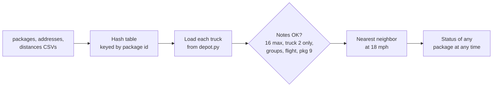

# Package Routing System

Plans a same-day delivery run: 40 packages, 3 trucks, 2 drivers, Salt Lake City. It covers **107.4 miles** and
nothing is late.

## The day

```text
8:00   truck 1 out
8:06   4300 S 1300 E
8:13   4580 S 2300 E     three packages, one of them due at 9:00
9:05   truck 2 out       flight landed. four packages can only ride this truck
9:53   truck 1 back
10:20  truck 3 out       package 9 has the right street. truck 1's driver takes it
11:18  truck 2 back
12:11  truck 3 back
```

The 9:00 package is the second stop, not the first. 4300 S 1300 E is closer, and that box has to ride with the 9:00
one.

Ask about package 9 at 9:00 and it still says 300 State St. At 11:00 it says 410 S State St, delivered at 10:59.

## How it works



| Piece          | File                    | What it does                                               |
| -------------- | ----------------------- | ---------------------------------------------------------- |
| Hash table     | `routing/hash_table.py` | Chaining hash table, so a lookup doesn't walk the list     |
| Loads          | `routing/depot.py`      | Which packages ride which truck, checked against the notes |
| Route          | `routing/truck.py`      | Drives to whichever of its packages is closest             |
| Package status | `routing/package.py`    | Where a package is at any time of day                      |

## Running it

Python 3.11 or newer, nothing to install.

```bash
python3 -m routing mileage
python3 -m routing route
python3 -m routing lookup 9 --at "9:00 AM"
python3 -m unittest discover -s tests -v
```

| Command                     | What it does                      |
| --------------------------- | --------------------------------- |
| `mileage`                   | Total miles for the day           |
| `route`                     | The full timeline, truck by truck |
| `lookup <id> --at "<time>"` | One package's status at that time |

## License

[MIT](LICENSE).
